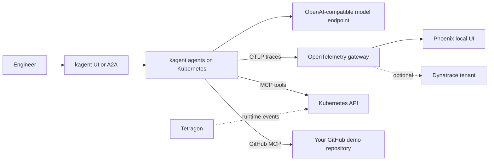

# Replicate the Agent Observability Workshop

This guide is a build-and-study manual for recreating the workshop as an
operations engineer. It explains the architecture, the purpose of the important
repositories and files, two deployment profiles, credential boundaries, how to
prove the system works, and how to extend or remove it.

The recommended learning path is to begin with the **vendor-neutral profile**:
run Kubernetes, kagent, the OpenTelemetry Collector, and Phoenix without a
Dynatrace account. Add Dynatrace only after you can deploy an agent, invoke it,
and see its trace in Phoenix. Dynatrace is an optional observability backend,
not a requirement for Kubernetes, kagent, agent execution, or Phoenix tracing.

!!! warning "Never commit credentials"
    Keep model keys, room passwords, GitHub tokens, and Dynatrace tokens in a
    secret manager or environment variables. Do not put live values in manifests,
    command history, screenshots, issue comments, or documentation. If a value
    has been pasted into a public or shared location, rotate it.

## 1. What You Will Build

The workshop deploys seven kagent agents: one SRE investigator and a six-agent
BMAD software-delivery crew. The SRE agent reads Kubernetes state and diagnoses
faults. The BMAD crew uses a GitHub MCP server to work with issues, branches,
files, and pull requests in a repository you control.

An OpenTelemetry Collector receives agent traces, enriches them with Kubernetes
metadata, normalizes GenAI attributes, and fans telemetry out to Phoenix and,
when configured, Dynatrace. Phoenix is a local trace and evaluation backend.
Dynatrace adds tenant-wide AI observability, Kubernetes topology, evaluation
write-back, and optimization artifacts.



## 2. Choose a Deployment Profile

| Profile | Required services | What it proves | External account needed |
|---|---|---|---|
| Minimal, vendor-neutral | Kind, kagent, OpenTelemetry Collector, Phoenix, a model endpoint | Agent lifecycle, Kubernetes tool use, traces, and local evaluations | A model endpoint; no Dynatrace account |
| Software-building crew | Minimal profile plus GitHub MCP and a fine-grained GitHub token | BMAD agents create issues and pull requests in a selected repository | GitHub |
| Security lab | Minimal profile plus Agent Sandbox baseline and Tetragon | Pod admission/network isolation and runtime process events | No additional account; Tetragon needs host eBPF support |
| Full workshop | Above plus Dynatrace Operator, DynaKube, Dynatrace OTLP export, and optional `dt-evals`/`dtctl` | Tenant AI observability, Smartscape topology, evaluations, and optimization assets | Dynatrace tenant and scoped tokens |

Start with the minimal profile. If the agent cannot call the model or Phoenix
does not receive traces, Dynatrace will not fix those underlying issues.

## 3. Source Repositories

Fork the workshop repository before changing it. Keep your fork as `origin` and
the source project as `upstream`; this makes it possible to pull updates without
confusing your changes with the workshop maintainers' changes.

| Repository | Role in the lab |
|---|---|
| [Workshop repository](https://github.com/henrikrexed/dynatrace-AI-Agent-Workshop) | Infrastructure code, agent manifests, documentation, scenarios, and evaluation assets. |
| [Your workshop fork](https://github.com/Murattx/dynatrace-AI-Agent-Workshop) | The example fork used in this Codespace. In your own lab, replace this with your GitHub account's fork. |
| [Sympozium Todo demo](https://github.com/Murattx/sympozium-todo-demo) | Example GitHub target for the BMAD crew. Treat it as a workflow target, not a deployable app until it has a runnable entry point and deployment definition. |
| [isItObservable/Kagent BMAD manifests](https://github.com/isItObservable/Kagent/tree/main/manifests/bmad-crew) | Upstream reference for the BMAD crew adapted by this workshop. |
| [kagent](https://github.com/kagent-dev/kagent) | Kubernetes-native agent runtime, CRDs, controller, UI, and Helm charts. |
| [kind](https://github.com/kubernetes-sigs/kind) | Runs a Kubernetes cluster using Docker containers as nodes. |
| [OpenTelemetry Operator](https://github.com/open-telemetry/opentelemetry-operator) and [Collector](https://github.com/open-telemetry/opentelemetry-collector) | Reconciles the collector and receives/exports telemetry. |
| [Arize Phoenix](https://github.com/Arize-ai/phoenix) | Local trace inspection and LLM evaluation UI. |
| [GitHub MCP Server](https://github.com/github/github-mcp-server) | GitHub tools exposed to the BMAD agents through MCP. |
| [Tetragon](https://github.com/cilium/tetragon) | eBPF-based runtime security observability and enforcement. |
| [Kubernetes Agent Sandbox](https://github.com/kubernetes-sigs/agent-sandbox) | Optional upstream sandbox controller. The workshop's current baseline is a repo-owned PSA/NetworkPolicy manifest. |
| [Dynatrace Operator](https://github.com/Dynatrace/dynatrace-operator) | Optional Kubernetes monitoring and topology integration for Dynatrace. |
| [dt-evals](https://github.com/dynatrace-oss/dt-evals) | Optional config-driven evaluation against Dynatrace spans. |
| [OpenTelemetry Demo Light](https://github.com/henrikrexed/opentelemetry-demo-light) | Optional sample microservice app for diagnostic scenario 12; not the Todo demo. |

The `sympozium-todo-demo` repository currently describes a Todo board, but its
`package.json` has no `start` script and the repository has no Kubernetes
deployment manifests. The BMAD crew can still use it as a GitHub planning/code
target if its token has access; it does not become a running app merely by
setting `GH_DEMO_REPO`. Have the crew implement a runnable application and
container/deployment path, or select a repository that already provides them.

## 4. Repository Map

| Path | Responsibility |
|---|---|
| `.devcontainer/` | Codespace image, pinned tools, lifecycle hooks, secret contract, and bootstrap helpers. |
| `.devcontainer/devcontainer.json` | Declares Codespace ports, environment, CPU/memory recommendation, and create/start hooks. |
| `.devcontainer/postCreate.sh` | Creates/reuses Kind, attempts model-proxy exchange, installs the platform, and reports secret presence. |
| `.devcontainer/postStart.sh` | Restores the existing cluster after a Codespace resume and refreshes the docs deployment. |
| `.devcontainer/bootstrap/` | Resource checks, cluster creation, tool install, model-key dispenser, and personalized docs rendering. |
| `cluster/kind-config.yaml` | Kind cluster name, Kubernetes node image, and host-to-NodePort mappings. Current config has a control-plane node and a worker node. |
| `cluster/install.sh` | Idempotent Phase 2 platform install; component toggles are documented below. |
| `cluster/versions.env` | Pinned Helm chart/image versions and model endpoint defaults. |
| `cluster/secrets.sh` | Creates Kubernetes Secrets from environment variables without printing their values. |
| `cluster/otel/` | OpenTelemetry Operator and gateway Collector configuration. |
| `cluster/kagent/` | kagent Helm values, UI NodePort, and runtime configuration. |
| `cluster/phoenix/` | Phoenix Deployment and OTLP/UI Service. |
| `cluster/tetragon/` | Tetragon values and sensitive-file access policy. |
| `cluster/agent-sandbox/` | Restricted Pod Security Admission and default-deny network policy baseline. |
| `cluster/dynatrace/` | Optional Dynatrace Operator/DynaKube configuration and optimization YAML. |
| `agents/mcp/` | Shared model config and GitHub MCP server definitions. |
| `agents/sre/` | SRE agent prompt, tool permissions, and configuration. |
| `agents/bmad-crew/` | Analyst, PM, architect, developer, QA, and orchestrator agents. |
| `agents/install-agents.sh` | Applies model config, MCP servers, SRE agent, and BMAD crew. |
| `scenarios/` | Isolated fault injection, prompts, answer keys, and cleanup scripts. |
| `evals/` | Phoenix evaluation and optional Dynatrace `dt-evals` configuration/runners. |
| `docs/` | MkDocs source for the module-by-module workshop. |
| `cluster/mkdocs/` | In-cluster personalized workshop site served on port 8000. |

## 5. Requirements and Sizing

### Recommended full lab

- GitHub account and a fork of the workshop repo.
- GitHub Codespace with **4 CPU cores, 16 GB RAM, and 32 GB storage**. Smaller
  machines may run the minimal profile but are not recommended for all operators,
  Tetragon, agents, Phoenix, and the optional demo app together.
- Docker-in-Docker, installed by the devcontainer feature, because Kind nodes are
  Docker containers.
- Network access to GitHub Container Registry, public Helm/OCI registries, the
  selected model endpoint, and (if enabled) Dynatrace.
- `kubectl`, Helm, Kind, Node.js, `dtctl`, and `envsubst`; these are installed or
  pinned by the Codespace image. `mkdocs` and `dt-evals` are optional for the
  bootstrap: the docs are served in-cluster, and the eval runner has an `npx`
  fallback.

The current Kind config maps Phoenix `30606 -> 6006`, kagent UI `30080 -> 8080`,
and MkDocs `30800 -> 8000`. Codespaces may wrap these in an authenticated
forwarded URL. The ports are host-side interfaces; the app Services remain in
the cluster.

### Vendor-neutral minimum

You need a Docker host, Kind, kubectl, Helm, `envsubst`, and access to a model
endpoint. Phoenix and the collector can run without Dynatrace. Skip Tetragon and
the isolation baseline initially if your host cannot support eBPF or you want a
smaller resource footprint. The SRE agent requires model access; the BMAD crew
needs GitHub MCP credentials for real repository operations.

## 6. Credentials and Trust Boundaries

Use the full
[Codespace secrets contract](https://github.com/henrikrexed/dynatrace-AI-Agent-Workshop/blob/main/.devcontainer/SECRETS.md)
as the authoritative list. The table below describes which parts of the
workshop each credential unlocks.

| Variable | Required for | Notes |
|---|---|---|
| `WORKSHOP_PREFIX` | Stable attendee/service identity | Not a secret. Use a lowercase label matching `^[a-z][a-z0-9-]{1,18}$`. It is auto-derived if omitted. |
| `WORKSHOP_ROOM_PASSWORD` and `WORKSHOP_DISPENSER_URL` | Workshop-hosted model access | The bootstrap exchanges these for a per-attendee proxy URL and budget-capped key in the gitignored `.workshop-llm.env`. The host supplies both values. |
| `DEEPSEEK_API_KEY` or `LLM_API_KEY` | Direct model access when not using the dispenser | Optional self-host/CI alternative. The current default model is DeepSeek `deepseek-chat` over an OpenAI-compatible API. A compatible endpoint/provider requires matching ModelConfig and values changes. |
| `GH_PAT` | BMAD GitHub write tools | Fine-grained token scoped to one target repository; only Contents, Issues, and Pull Requests permissions needed by the workflow. Codespaces `GITHUB_TOKEN` may be a read/write fallback only when it has access to that repo. |
| `GH_DEMO_REPO` | BMAD task target | Set as `owner/repo`; tell the orchestrator which repository to work on. |
| `DT_TENANT_URL` and `DT_API_TOKEN` | Dynatrace OTLP ingest and DynaKube data ingest | `DT_API_TOKEN` needs trace, metric, and log ingest scopes. The URL must be the tenant's `.live.` ingest domain. |
| `DYNATRACE_API_TOKEN` | Dynatrace Operator and optional `dt-evals` | Needs Kubernetes monitoring/ActiveGate scopes plus `storage:spans:read` and `storage:events:write` for the evaluation path. Keep distinct from an ingest-only token. |
| `DT_PLATFORM_TOKEN` and optionally `DT_ENVIRONMENT` | `dtctl` optimization assets | Platform token for dashboard, notebook, Guardian, and workflow deployment; platform URL is normally `.apps.dynatrace.com`. |

The Codespace's GitHub token is separate from the model proxy and Dynatrace
credentials. A working GitHub MCP does not mean model inference works, and a
working model does not imply access to the target repository.

## 7. Build the Vendor-Neutral Profile

### Step 1: Fork and open the project

1. Fork the [workshop repository](https://github.com/henrikrexed/dynatrace-AI-Agent-Workshop)
   to your account.
2. In your fork, create a Codespace on `main` and choose the recommended
   4-core/16-GB machine for the full lab.
3. If you want a minimal first boot, edit `.devcontainer/devcontainer.json`
   before creating the Codespace and add these entries under `containerEnv`:

   ```json
   "INSTALL_DYNATRACE": "false",
   "INSTALL_TETRAGON": "false",
   "INSTALL_AGENT_SANDBOX": "false"
   ```

   Keep the existing `CLUSTER_TOOL`, `CLUSTER_NAME`, and `KUBECONFIG` entries.
   These flags are read by `cluster/install.sh` when `postCreate.sh` installs
   the platform. On an already-created cluster, setting a flag only skips that
   component on the next install; it does not uninstall a release already
   installed.

4. Configure one model access path before expecting agents to answer:
   - Workshop: add the host-provided room password and dispenser URL as
     Codespaces secrets.
   - Self-hosted: use a provider key for the configured model endpoint and set
     it as a Codespaces secret, or load it securely in the shell before running
     `cluster/secrets.sh`.
5. Wait for `postCreate` to finish. It creates the Kind cluster and installs the
   platform automatically. Inspect
   [the secret contract](https://github.com/henrikrexed/dynatrace-AI-Agent-Workshop/blob/main/.devcontainer/SECRETS.md)
   before configuring the optional GitHub or Dynatrace integrations.

### Step 2: Check the cluster and platform

```bash
kubectl config current-context
kubectl get nodes
kubectl get pods -A
kubectl -n opentelemetry-operator-system get pods,svc
kubectl -n phoenix get pods,svc
```

The current context should be `kind-workshop`; the Kind nodes should be Ready.
The Collector should be in `opentelemetry-operator-system`, and Phoenix should
be in `phoenix`. Open the local Phoenix URL on port 6006. If the bootstrap ran
without Dynatrace credentials, the Collector is designed to keep Phoenix export
working while Dynatrace export is disabled.

### Step 3: Make model credentials available

In a Codespace, the preferred method is to set secrets in GitHub and rebuild so
the lifecycle hooks receive them. For a one-off local shell, enter secret values
at hidden prompts rather than typing them into a command or committing them:

```bash
read -r -s -p 'Model API key: ' LLM_API_KEY
printf '\n'
export LLM_API_KEY
export WORKSHOP_PREFIX=solo-lab
bash cluster/secrets.sh
```

For the hosted model dispenser, set `WORKSHOP_ROOM_PASSWORD` and
`WORKSHOP_DISPENSER_URL` in the shell environment, then run:

```bash
bash .devcontainer/bootstrap/dispense-llm.sh
source .workshop-llm.env
export WORKSHOP_PREFIX=solo-lab
bash cluster/secrets.sh
```

`dispense-llm.sh` writes the proxy key to `.workshop-llm.env` with restrictive
permissions; the file is gitignored. Do not display or paste its contents. The
explicit `WORKSHOP_PREFIX` keeps the resource names and telemetry identity
consistent between platform and agent installation.

### Step 4: Install the agents and verify readiness

If the platform was installed by `postCreate`, apply the agent set:

```bash
bash agents/install-agents.sh
kubectl -n kagent get agents
kubectl -n kagent get pods
```

The expected Agent resources are `murattx-sre-agent` (or your prefix's SRE
agent) and six `*-bmad-*` resources. For a different prefix, replace
`murattx` with your own. The acceptance conditions should become `ACCEPTED=True`
and `READY=True`; corresponding agent pods should be `1/1 Running`.

If BMAD should modify a repository, make sure `GH_PAT` and `GH_DEMO_REPO` are
available before installing. The MCP token is injected into the MCP workload at
apply time; it is not safe to use a broad personal token. For a SRE-only learning
exercise, GitHub write access is not necessary, but the model Secret still is.

### Step 5: Send a read-only smoke request

Open the kagent UI on port 8080, select the SRE agent, and ask it to list pods in
the `kagent` namespace. Or use the in-cluster A2A interface:

```bash
kubectl run a2a --rm -i --restart=Never --image=curlimages/curl:8.10.1 -n kagent \
  --command -- curl -sS -m 300 -X POST -H 'Content-Type: application/json' \
  --data '{"jsonrpc":"2.0","id":"smoke-1","method":"message/send","params":{"message":{"role":"user","messageId":"smoke-1","kind":"message","parts":[{"kind":"text","text":"List the pods in the kagent namespace and briefly identify any that are not healthy."}]}}}' \
  http://kagent-controller.kagent:8083/api/a2a/kagent/solo-lab-sre-agent
```

Use the actual prefix in the endpoint. A completed JSON-RPC task and an agent
answer prove that the controller, workload, model endpoint, and Kubernetes tool
path are functioning together.

### Step 6: Confirm traces in Phoenix

Open Phoenix on port 6006. In the `default` project, inspect recent traces and
look for agent, LLM, and tool spans. Expected span kinds include `AGENT`, `LLM`,
and `TOOL`; model spans should identify the configured model. The trace may
contain prompt and response content, so treat Phoenix access and exports as
sensitive data.

You can inspect recent span metadata through Phoenix's API at
`http://localhost:6006/v1/projects/default/spans`. Avoid logging or sharing
prompt/response bodies when debugging.

## 8. Install Outside Codespaces

Codespaces is the tested path because the devcontainer configures Docker-in-
Docker, versions, kubeconfig, forwarded ports, and lifecycle hooks. A Linux host
can run the same scripts if it has Docker, Kind, kubectl, Helm, `envsubst`, and
the pinned tool versions available. You are responsible for opening local ports
and providing a working model endpoint.

From the repository root, a small vendor-neutral install is:

```bash
export CLUSTER_TOOL=kind
export CLUSTER_NAME=workshop
export WORKSHOP_PREFIX=solo-lab
bash .devcontainer/bootstrap/create-cluster.sh
INSTALL_DYNATRACE=false \
INSTALL_TETRAGON=false \
INSTALL_AGENT_SANDBOX=false \
INSTALL_MKDOCS=false \
  bash cluster/install.sh
```

This leaves kagent, the OpenTelemetry Operator/gateway, and Phoenix enabled.
Then provision a model key and apply the agents using Steps 3–5 above. To keep
GitHub operations off, do not set a write token; for the full BMAD workflow,
provide narrowly scoped credentials for a repository you own.

The scripts are idempotent and can be re-run, but component flags are install
switches, not uninstall switches. On a cluster where Dynatrace or Tetragon was
already installed, setting the flag to `false` does not remove it. Start from a
fresh Kind cluster for a clean minimal profile.

## 9. Add the Optional Dynatrace Backend

Add Dynatrace after Phoenix tracing works. Configure the secrets listed in
[`.devcontainer/SECRETS.md`](https://github.com/henrikrexed/dynatrace-AI-Agent-Workshop/blob/main/.devcontainer/SECRETS.md):

1. `DT_TENANT_URL`: the `.live.` tenant ingest URL.
2. `DT_API_TOKEN`: OTLP ingest scopes for traces, metrics, and logs.
3. `DYNATRACE_API_TOKEN`: Kubernetes monitoring/ActiveGate scopes; add the
   spans-read and evaluation-write scopes if using `dt-evals`.
4. `DT_PLATFORM_TOKEN`: platform token for `dtctl` deployment of optimization
   assets.
5. `DT_ENVIRONMENT`: optional `.apps.` platform URL, derived when possible.

Rebuild the Codespace or export the values securely, then reconcile the stack:

```bash
bash cluster/secrets.sh
bash cluster/install.sh
```

Check the `DynaKube`, Collector, and pods:

```bash
kubectl -n dynatrace get dynakube
kubectl -n opentelemetry-operator-system get otelcol,pods
kubectl -n opentelemetry-operator-system logs deploy/otel-gateway-collector --tail=100
```

The Collector exports to Phoenix and Dynatrace in parallel. If Dynatrace values
are absent, the workshop can still be useful locally, but it cannot send data to
your tenant or create Smartscape topology. Keep tenant ingest (`.live.`) and
platform (`.apps.`) URLs/tokens distinct. Never solve a missing-scope problem by
making a token broader than the workshop requires.

Optimization dashboards, notebooks, Site Reliability Guardian, and workflow
assets are under
[`cluster/dynatrace/optimization/`](https://github.com/henrikrexed/dynatrace-AI-Agent-Workshop/tree/main/cluster/dynatrace/optimization).
They are Dynatrace-specific; they are not required for the vendor-neutral path.

## 10. Add Security and Fault Scenarios

### Agent isolation

The baseline in `cluster/agent-sandbox/isolation.yaml` is maintained in this
repository. It applies restricted Pod Security Admission and a default-deny
NetworkPolicy to the `agent-sandbox` namespace. It is not the same thing as
installing the upstream Agent Sandbox controller. Read
[`cluster/agent-sandbox/README.md`](https://github.com/henrikrexed/dynatrace-AI-Agent-Workshop/blob/main/cluster/agent-sandbox/README.md)
before adding stronger runtime isolation such as kagent substrate or a
gVisor/Kata solution.

Verify the baseline with:

```bash
kubectl get ns agent-sandbox --show-labels
kubectl -n agent-sandbox get networkpolicy
```

Tetragon is optional for the minimal profile and depends on host-kernel eBPF
support. When installed, use the sensitive-file policy and lab instructions in
[`03-secure.md`](03-secure.md). Prefer the policy's detection action while
learning; enforcement can terminate workloads and depends on the kernel.

### SRE diagnosis

List scenarios and use the explicit cleanup command after every injection:

```bash
bash scenarios/run.sh list
bash scenarios/run.sh inject 01
kubectl get pods -n workshop-faults
# Ask the SRE agent to investigate; compare against the scenario answer key.
bash scenarios/run.sh cleanup 01
```

Scenarios 01–03 use only isolated Kubernetes faults. Scenario 12 also needs the
optional OpenTelemetry Demo Light app and a working observe pipeline. Its
deployment is opt-in:

```bash
INSTALL_OTEL_DEMO=true bash cluster/install.sh
```

## 11. Evaluation and Optimization

### Phoenix evaluation

Phoenix is the provider-neutral starting point for trace inspection and
evaluation. Generate agent traffic, select LLM spans in the Phoenix UI, add
examples to a dataset, and configure an LLM evaluator. The evaluator itself also
needs a reachable model endpoint. A local Phoenix instance can store and inspect
traces without Dynatrace; a model judge still consumes model tokens.

For the version-pinned scripted workflow:

```bash
cd evals
uv sync
uv run python phoenix/run_phoenix_eval.py
uv run python phoenix/run_phoenix_eval.py --from-phoenix
```

See [`evals/phoenix/README.md`](https://github.com/henrikrexed/dynatrace-AI-Agent-Workshop/blob/main/evals/phoenix/README.md) and
[`06-evaluate.md`](06-evaluate.md) for dataset, evaluator, and span-mapping
details.

### Optional Dynatrace evaluation and optimization

`dt-evals` reads spans from Dynatrace and writes evaluation events back, so it
requires Dynatrace credentials in addition to the model judge. `dtctl` deploys
the Dynatrace-specific optimization artifacts. See
[`evals/dt-evals/README.md`](https://github.com/henrikrexed/dynatrace-AI-Agent-Workshop/blob/main/evals/dt-evals/README.md)
and
[`cluster/dynatrace/optimization/README.md`](https://github.com/henrikrexed/dynatrace-AI-Agent-Workshop/blob/main/cluster/dynatrace/optimization/README.md).
These are advanced optional paths, not prerequisites for running the agents.

## 12. Verification Checklist

Use this as a reproducible acceptance checklist after a fresh install:

```bash
# Cluster and baseline platform
kubectl config current-context
kubectl get nodes
kubectl get pods -A

# Agents and tool servers
kubectl -n kagent get agents
kubectl -n kagent get mcpservers,remotemcpservers
kubectl -n kagent get pods

# Telemetry and local UIs
kubectl -n opentelemetry-operator-system get pods,svc
kubectl -n phoenix get pods,svc
curl -I http://localhost:6006
curl -I http://localhost:8080

# Optional personalized docs UI
curl -I http://localhost:8000
```

Acceptance for the vendor-neutral path: all seven agent resources are accepted
and ready, their pods are `1/1 Running`, a read-only SRE smoke request completes,
and Phoenix contains agent/LLM/tool spans for that request. Add a Dynatrace
acceptance gate only when tenant credentials are configured: spans visible in
AI Observability and Kubernetes entities present in Smartscape.

The repository's validation harness is useful before and after changes:

```bash
bash .devcontainer/test/run-tests.sh --static
bash .devcontainer/test/run-tests.sh --no-rebuild
```

Static checks do not prove external model or Dynatrace credentials work. The
live suite reports those checks as partial when the needed secrets or external
services are unavailable. For a strict MkDocs build, install
`requirements-docs.txt` and run `mkdocs build --strict`.

## 13. Troubleshooting by Symptom

| Symptom | First check | Likely action |
|---|---|---|
| `kubectl` uses `localhost:8080` or has no current context | `kubectl config current-context`; `kind get clusters` | For this cluster run `kind export kubeconfig --name workshop`, then select `kind-workshop`. |
| Agent accepted but `READY=False`; pod has `CreateContainerConfigError` | `kubectl -n kagent describe pod <agent-pod>` | Look for `secret "kagent-deepseek" not found`; load a real model key and run `bash cluster/secrets.sh`, then wait for the Deployment to roll out. |
| Agent pod runs but model requests fail | `kubectl -n kagent logs deploy/<agent-deployment>` | Confirm the model provider, API-compatible base URL, key Secret name/key, and network reachability. Never paste the key into logs or support messages. |
| GitHub MCP is unready or tools return auth errors | `kubectl -n kagent get mcpservers,remotemcpservers`; inspect MCP pod logs | Check that `GH_PAT` can access the selected repository and has only the required repo permissions; re-run `agents/install-agents.sh`. |
| Phoenix UI works but has no spans | Check agent smoke request, then Collector logs | Verify agent OTLP endpoint and Collector pipelines; check `kubectl -n opentelemetry-operator-system logs deploy/otel-gateway-collector`. |
| Phoenix traces exist but Dynatrace has none | Check `DT_TENANT_URL`, `DT_API_TOKEN`, and Collector exporter logs | Use the `.live.` ingest host and correct OTLP scopes; rerun secret provisioning and `cluster/install.sh`. |
| DynaKube reports `ScopeMissing` | `kubectl -n dynatrace describe dynakube dynakube` | The operator token needs Kubernetes monitoring/ActiveGate scopes; an ingest-only token is not sufficient. |
| Tetragon is not ready or policy is not loaded | `kubectl -n tetragon get pods`; `tetra tracingpolicy list` | Check eBPF/BTF and kernel support; see [`cluster/tetragon/README.md`](https://github.com/henrikrexed/dynatrace-AI-Agent-Workshop/blob/main/cluster/tetragon/README.md). |
| Docs site is stale or unready | `kubectl -n workshop-docs get pods`; port 8000 | Re-run `bash .devcontainer/bootstrap/render-docs.sh` then `kubectl -n workshop-docs rollout restart deploy/mkdocs`. |

Use the broader [Troubleshooting](troubleshooting.md) page for module-specific
diagnostics. Collect sanitized status/events, not Secret YAML or model prompts,
when asking for help.

## 14. Reset and Tear Down

Clean up each injected scenario with `bash scenarios/run.sh cleanup <id>`. To
remove the workshop platform while keeping the Kind cluster, run
`bash cluster/uninstall.sh`; read the script first because it intentionally
keeps namespaces and Secrets. For a complete disposable-lab reset, delete the
Kind cluster:

```bash
kind delete cluster --name workshop
```

This deletes all Kubernetes resources and local cluster state. It does not revoke
GitHub, model-provider, or Dynatrace credentials; rotate/revoke those separately
when they are no longer needed.

## 15. Suggested Study Order

1. Read [kagent in 5 minutes](kagent-explainer.md), then inspect the SRE and BMAD
   manifests under `agents/`.
2. Trace the platform install from `.devcontainer/postCreate.sh` to
   `cluster/install.sh`, then compare it with `cluster/versions.env` and the
   component manifests.
3. Follow a smoke request from the kagent UI/A2A endpoint through the model call
   and Kubernetes tool call; inspect its spans in Phoenix.
4. Read the Collector processors/exporters in
   `cluster/otel/collector-gateway.yaml`; identify which steps are OpenTelemetry
   standard configuration and which are workshop-specific attribute mapping.
5. Run one fault scenario and grade the SRE answer against its ground truth.
6. Add Dynatrace only after the local trace path is clear; inspect the
   optimization DQL and eval configuration as separate integrations.
7. Change one component at a time, rerun the acceptance checks, and keep notes
   about resource use, token cost, trace shape, and failure modes.

For the guided module sequence, continue with [00 — Setup](00-setup.md), then
work through modules 01–07. The [Run of show](run-of-show.md) is the shorter
facilitated path; this page is the longer self-study and replication reference.